### Тема 3. Індикатор рівня звуку

**Призначення.** Модуль визначає гучність звукового сигналу за останніми відліками й видає її у вигляді рівня від 0 до 8, придатного для керування стовпчиком світлодіодів.

**Вимоги.**

1. Модуль повинен приймати 16-бітні знакові відліки (від −32768 до 32767). Один запис у регістр `IN` це один відлік.
2. Модуль повинен зберігати останні N відліків, де N задається процесором в діапазоні від 1 до 8.
3. Після кожного нового відліку модуль повинен обчислити пік: найбільше значення модуля серед збережених відліків.
4. Модуль повинен перетворити пік на цілий рівень від 0 до 8 так, щоб нульовий сигнал давав рівень 0, а максимально можливий за модулем сигнал давав рівень 8. Діапазон розбивається на рівні сходинки.
5. Модуль повинен правильно обробляти відлік −32768: його модуль на 1 більший за найбільше додатне значення.
6. Якщо N зменшили, модуль повинен враховувати тільки останні N відліків.
7. Рівень повинен бути виведений на пін `level[3:0]` для підключення світлодіодів (за наявності плати).

**Регістри.**

| Зсув | Назва | Доступ | Значення |
|---|---|---|---|
| 0x00 | `IN` | запис | Вхідний відлік, [15:0], знакове число. Запис запускає один крок. |
| 0x04 | `N` | запис/читання | Розмір вікна, 1–8. |
| 0x08 | `PEAK` | читання | Поточний пік, ціле без знака. |
| 0x0C | `LEVEL` | читання | Поточний рівень, розряди [3:0], значення 0–8. |

**Верифікація.** Тестбенч повинен перевірити для кожного відліку значення `PEAK` і `LEVEL`:

1. N=4, відліки 100, −300, 50, 20, 10, 5.
2. N=1, відліки 32767, потім −32768.
3. N=3, відліки 0, 16384, 32767, 16384, 0, −16384, −32768.

**Склад проєкту (де що знаходиться).**

- **Модуль** (файл `.v`): AXI4-Lite інтерфейс з чотирма регістрами, буфер на 8 останніх відліків, пошук найбільшого модуля серед N останніх, перетворення піка на рівень. Пін `level[3:0]` виведений назовні.
- **Тестбенч модуля** (без процесора): записує `N`, потім по одному пише відліки в `IN`, після кожного читає `PEAK` і `LEVEL` і порівнює з числами, які ви порахували вручну.
- **Програма на C**: записує `N=4`, у циклі пише відліки в `IN`, читає `PEAK` і `LEVEL`, і порівнює або друкує їх.
- **Block Design**: MicroBlaze і ваш IP. Пін `level[3:0]` виведений назовні (Make External), щоб за наявності плати підключити світлодіоди.
- **Системна симуляція**: верхній тестбенч подає такт і скидання. На хвилях видно записи в `IN`, читання `PEAK` і `LEVEL`, і зміну `level[3:0]`.

---

# Індикатор рівня звуку

Курсовий проєкт, тема 3, варіант Р. Модуль приймає 16-бітні знакові відліки,
тримає вікно з останніх N, знаходить пік за модулем і показує рівень 0–8.

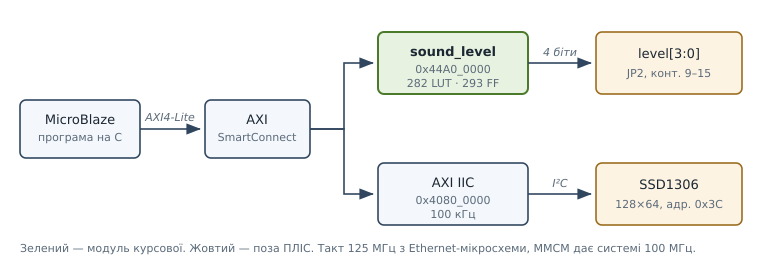

Дисплей - розширення понад завдання. Відліки генерує сама програма
пилкоподібним сигналом: мікрофона в системі немає.

<table><tr>
<td>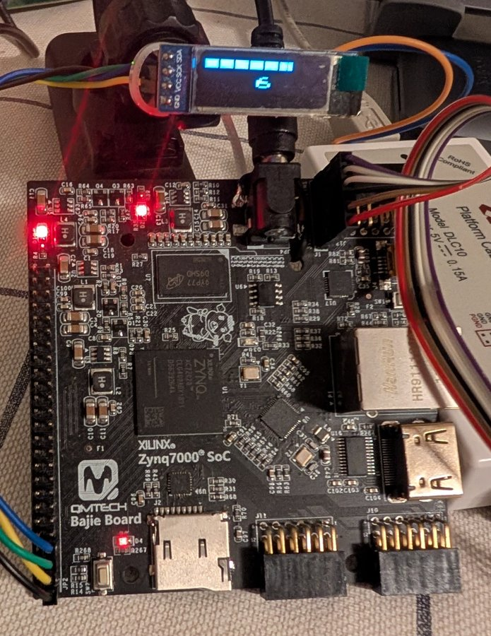</td>
<td>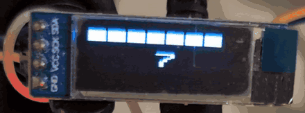</td>
</tr></table>

## Регістри

| Зсув | Назва | Доступ | Значення |
|---|---|---|---|
| 0x00 | `IN` | з/ч | Відлік, [15:0], знаковий. Запис = один крок |
| 0x04 | `N` | з/ч | Вікно 1–8. Читається вже обмеженим: 0 -> 1, 99 -> 8 |
| 0x08 | `PEAK` | ч | Пік за модулем, беззнаковий, 0–32768 |
| 0x0C | `LEVEL` | ч | Рівень 0–8 |

Запис у `PEAK` і `LEVEL` ігнорується без помилки шини.

## Три рішення, які ТЗ лишало на розробника

**Відлік −32768.** Його модуль на одиницю більший за максимум `signed [15:0]`.
Рахуємо двійкове доповнення, результат трактуємо як **беззнаковий**:
`~x + 1` для `0x8000` дає `0x8000` = 32768. Сімнадцятий розряд не потрібен.

**Пік -> рівень.** Діапазон 0–32768, рівнів дев'ять, сходинка 4096 - тобто
рівень це просто `peak[15:12]`. Наслідок: **рівень 8 буває лише на −32768**.

**Змінне N.** Буфер завжди на 8, але слоти поза вікном маскуються нулем -
нуль не може перемогти в порівнянні, бо пік невід'ємний.

## Очікувані результати

Пораховані вручну до запуску.

| | відліки | PEAK | LEVEL |
|---|---|---|---|
| N=4, витіснення | 100, −300, 50, 20, 10, 5 | 100, 300, 300, 300, 300, **50** | 0 |
| N=1, краї | 32767, −32768 | 32767, **32768** | **7, 8** |
| N=3, разом | 0, 16384, 32767, 16384, 0, −16384, −32768 | …32767…, **32768** | 0,4,7,7,7,4,**8** |

Жирним - те, заради чого сценарій і писався: витіснення з вікна, обробка
−32768 і поява рівня 8.

## Перевірка

`tb/tb_sound_level.v` - три сценарії, 15 перевірок, самозвіряння.

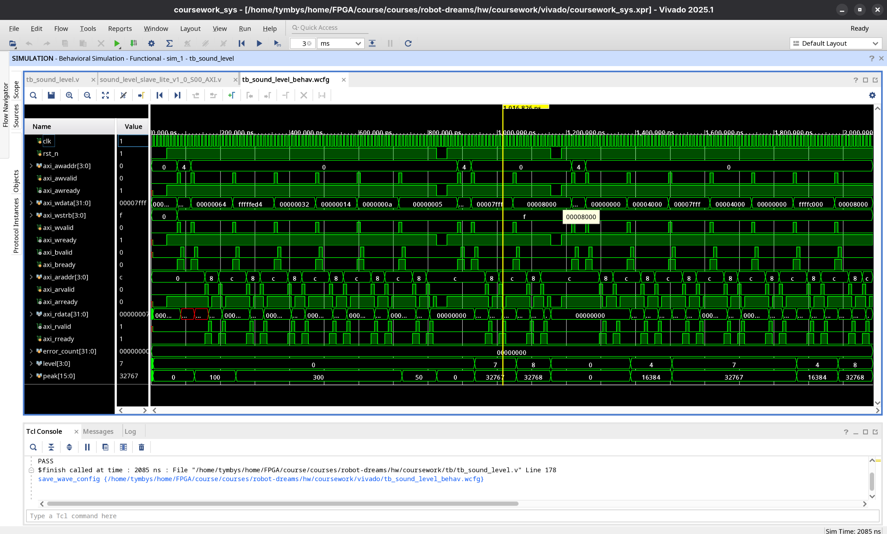

Копія в `broken/` відрізняється одним рядком: відлік береться з `slv_reg0`
замість шини, тобто відстає на крок.

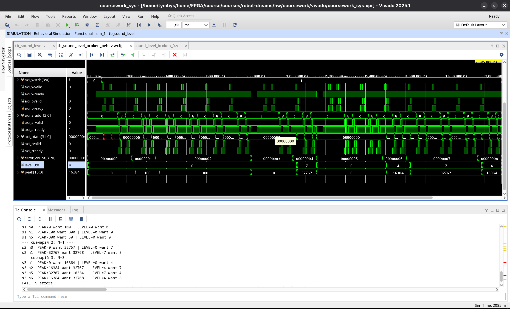

**9 помилок із 15, а не всі.** Там, де `PEAK` тримається кілька кроків
поспіль, зсунуте значення випадково збігається. Помилка видна у 60%
перевірок - на коротшому тестбенчі могла б не вилізти зовсім.

Обидва IP в одному проєкті: модулі зламаної копії перейменовані, DUT
обирається через `` `ifdef BROKEN ``.

## Система цілком

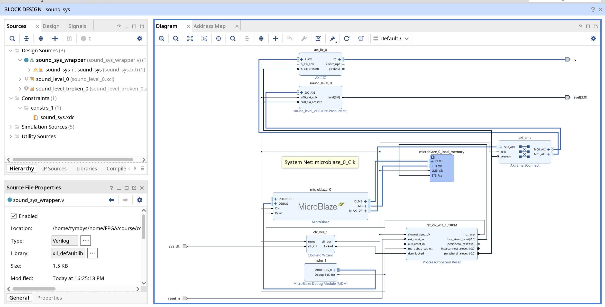

`tb/tb_sound_sys.v` тактує систему й спостерігає - відліки жене програма на
MicroBlaze. Поруч модель веденого I2C (`tb/i2c_slave_model.v`), яка відповідає
ACK лише на адресу `0x3C`.

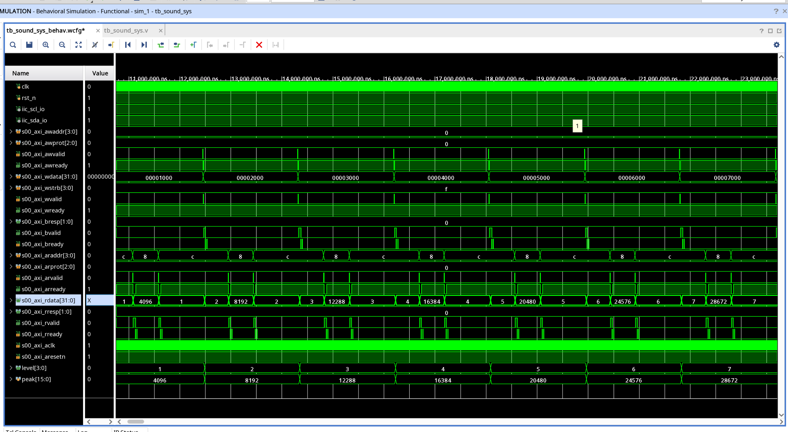

Запис `IN` за адресою `0`, далі читання `PEAK` за `8` і `LEVEL` за `c`.

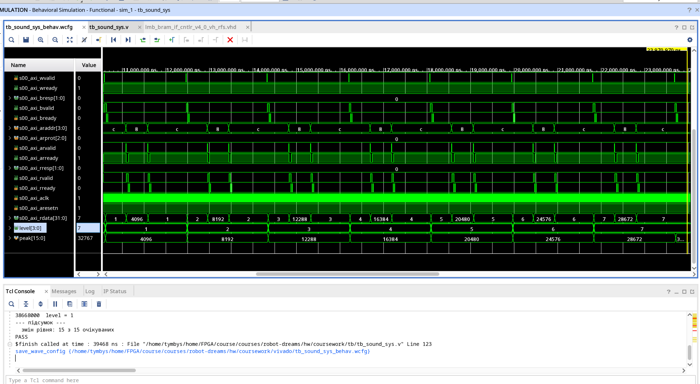

Тестбенч лічить не відліки, а моменти зміни `level`. Пилка має 17 відліків,
переходів 15: на першому відліку рівень уже дорівнює нулю після скидання,
а 28672 і 32767 потрапляють в одну сходинку - між ними 4095, а сходинка
4096. На хвилях це помітно: сегмент `7` удвічі ширший за сусідні.

## Плата

QMTECH Bajie Board, XC7Z020-CLG400. [Мануал плати](docs/QMTECH_ZYNQ7000_Bajie_Board_User_Manual_V01.pdf),
[виводи](constraints/sound_sys.xdc).

| Сигнал | Пін | Роз'єм |
|---|---|---|
| `sys_clk` | H16 | 125 МГц від Ethernet-мікросхеми |
| `reset_n` | U15 | кнопка SW2 |
| `iic_scl_io` / `iic_sda_io` | P20 / T19 | JP2, конт. 5 і 7 |
| `level[0..3]` | U20, W20, P19, R16 | JP2, конт. 9–15 |

Дві речі плата продиктувала сама: кварц заведений лише на PS, тож єдине
тактове джерело для PL - 125 МГц від RTL8211; світлодіодів на PL немає,
тому рівень іде на роз'єм.

## Дисплей

SSD1306 128×64 по I2C, адреса `0x3C`, 100 кГц. Повний кадр - 1024 байти,
≈92 мс, тому оновлюються лише два вікна: стовпчик і цифра.

Дві речі, яких не видно в симуляції:

**Сміття на старті.** GDDRAM після ввімкнення містить випадковий вміст, і він
лишався б назавжди - зворотний бік оптимізації «вікно замість кадру». `0xAF`
винесено з ініціалізації: спершу кадр нулями, потім вмикання.

**Занадто швидко.** Без пауз виходило ~35 кроків на секунду, стовпчик зливався.
Пауза 40 мс під `#ifndef SIMULATION`.

## Ресурси й час

| блок | LUT | FF | DSP | BRAM |
|---|---|---|---|---|
| **`sound_level_0`** | **282** | **293** | 0 | 0 |
| `microblaze_0` | 1052 | 934 | 0 | 0 |
| `axi_iic_0` | 370 | 372 | 0 | 0 |
| `axi_smc` | 309 | 388 | 0 | 0 |
| уся система | 2150 | 2149 | 0 | 16 |

Модуль виявився меншим за контролер I2C, який до нього приставили. BRAM уся
пішла під пам'ять процесора: вікно з восьми відліків живе в тригерах. DSP не
задіяні - множення в логіці немає.

**WNS +1.680 нс** при періоді 10 нс, порушень 0 з 6298. Але так було не одразу:

| крок | WNS | рівнів логіки | вузьке місце |
|---|---|---|---|
| вихідний | -13.338 | 33 | ланцюжок компараторів у тракті читання AXI |
| дерево + регістр `peak` | -3.705 | 18 | 32-бітне порівняння `N` перед деревом |
| регістр `n_win` | -0.726 | 12 | трасування: 72% затримки |
| конвеєр першого ярусу | **+1.680** | | вкладається |

Тричі поспіль спрацював один прийом - розірвати найдовший комбінаційний шлях
регістром, після чого оголюється наступний. Друге вузьке місце показове: воно
з'явилося через правку заради **коректності** (обмеження `N` по всьому
регістру), тобто це класичний розмін "правильно проти швидко".

Ціна - `PEAK` відстає від запису на два такти. Для AXI непомітно: читання
регістра займає більше тактів, ніж потрібно значенню, щоб устоятися.

## Що пішло не так

**Відставання на відлік.** `slv_reg0` у такті строба тримає ще попереднє
значення - обидва оновлюються по одному фронту. Правильно брати `S_AXI_WDATA`.
Ця ж помилка потім стала навмисною для кроку 3.

## Файли

| Що | Де |
|---|---|
| IP: HDL, `component.xml`, драйвер | [ip_repo/sound_level_1_0/](ip_repo/sound_level_1_0/) |
| Копія з навмисною помилкою | [broken/sound_level_broken_1_0/](broken/sound_level_broken_1_0/) |
| Тестбенч модуля | [tb/tb_sound_level.v](tb/tb_sound_level.v) |
| Тестбенч системи | [tb/tb_sound_sys.v](tb/tb_sound_sys.v) |
| Модель веденого I2C | [tb/i2c_slave_model.v](tb/i2c_slave_model.v) |
| Програма на C++ | [vitis/app_component/src/main.cpp](vitis/app_component/src/main.cpp) |
| Виводи плати | [constraints/sound_sys.xdc](constraints/sound_sys.xdc) |
| Мануал плати | [docs/QMTECH_ZYNQ7000_Bajie_Board_User_Manual_V01.pdf](docs/QMTECH_ZYNQ7000_Bajie_Board_User_Manual_V01.pdf) |
| Решта доказів за кроками завдання | [screenshots/](screenshots/) |

---

## Відповідність завданню

Сім обов'язкових кроків і докази до кожного.

### Крок 1 - IP з 3–5 регістрами AXI4-Lite (10)

> Створити IP, написати логіку модуля, скласти таблицю регістрів.

Чотири регістри, таблиця - [вище](#регістри). Логіка: вікно з восьми
відліків у тригерах, маскування поза вікном нулем, дерево компараторів,
рівень = `peak[15:12]`. Джерела - [ip_repo/sound_level_1_0/hdl/](ip_repo/sound_level_1_0/hdl/).

### Крок 2 - самоперевіряльний тестбенч (8)

> Не менше трьох сценаріїв, один граничний. Очікувані значення пораховані
> вручну до запуску й записані в README.

[tb/tb_sound_level.v](tb/tb_sound_level.v) піднімає AXI4-Lite-майстер і
проганяє три сценарії, 15 перевірок. Граничний - другий: `−32768`, єдиний
відлік, що дає рівень 8. Очікувані значення - у розділі
[Очікувані результати](#очікувані-результати).

### Крок 3 - зламана копія падає (5)

> Довести, що тест справді щось перевіряє.

[broken/](broken/sound_level_broken_1_0/) відрізняється одним рядком:
відлік береться з `slv_reg0` замість шини. `FAIL: 9 errors` - не всі 15,
бо там, де пік тримається кілька кроків, зсунуте значення випадково збігається.

### Крок 4 - Package IP та IP Catalog (5)

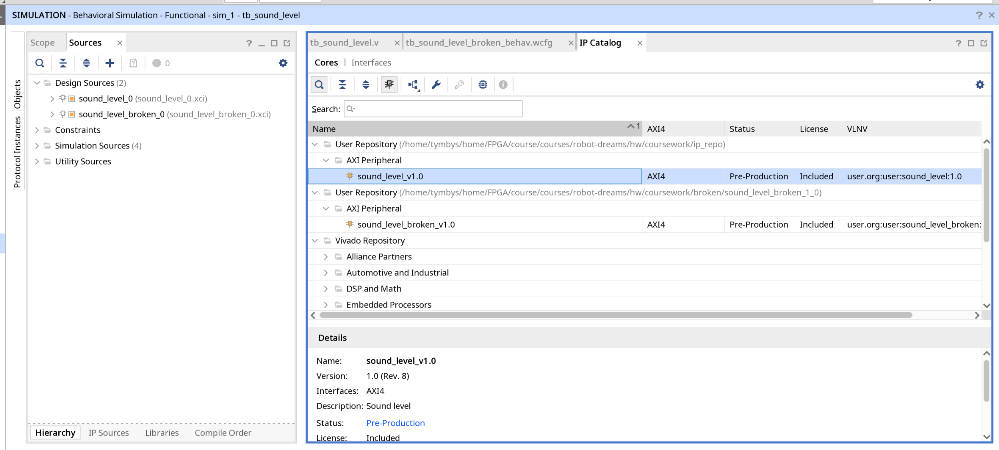

Обидва IP знайдені в каталозі; у дереві видно шляхи до репозиторіїв.
Налаштування репозиторіїв - `screenshots/ip_repository_settings.png`.

### Крок 5 - Block Design, Validate, Address Editor (7)

MicroBlaze, `sound_level_0`, AXI IIC і SmartConnect.

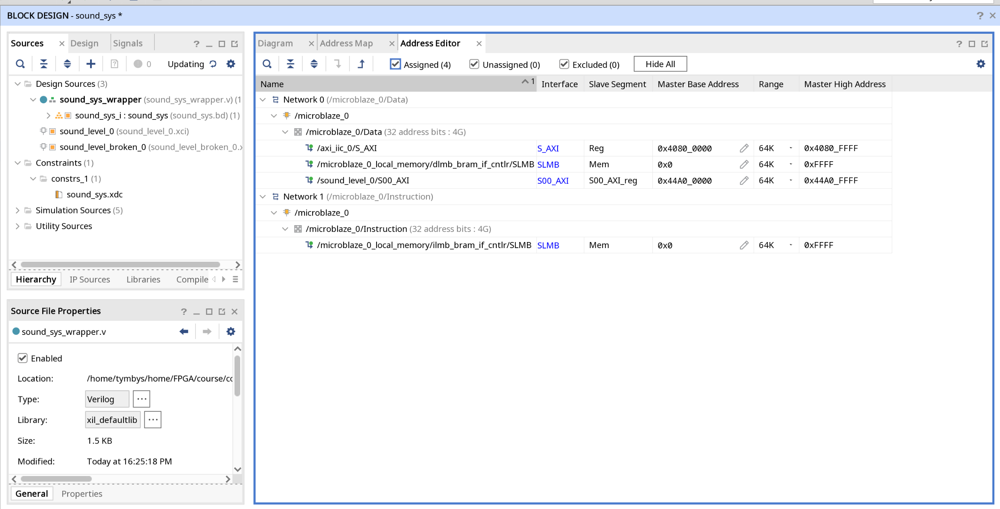

`0x44A0_0000` для модуля, `0x4080_0000` для I2C. У шапці - `Assigned (4),
Unassigned (0)`: сегментів без адреси не лишилося.

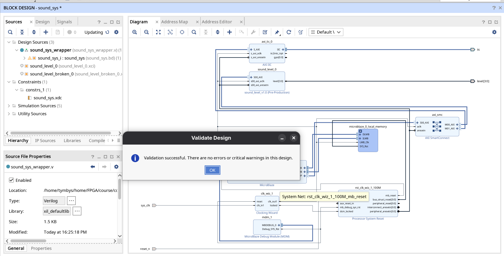

### Крок 6 - системна симуляція (10)

> Програма на C пише й читає регістри. На хвилях видно транзакції AXI4-Lite
> і реакцію модуля.

Запис відліку в `IN` за адресою `0`, далі читання `PEAK` за `8` і `LEVEL`
за `c`. Нижче `peak` і `level` відпрацьовують синхронно - це й є реакція
модуля. Програма - [main.cpp](vitis/app_component/src/main.cpp), загальний
вигляд усього прогону - `screenshots/sim_system_axi.png`.

### Крок 7 - Implementation, ресурси й час (5)

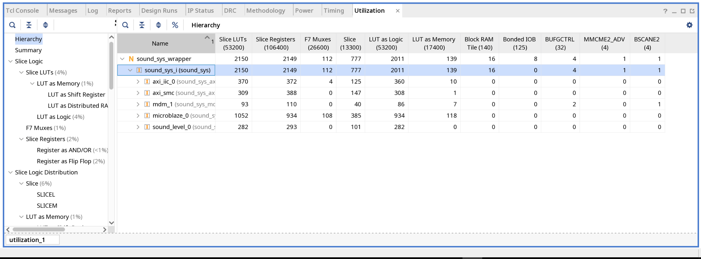

`sound_level_0` зайняв **282 LUT, 293 FF, 0 DSP, 0 BRAM** - менше за
контролер I2C поруч.

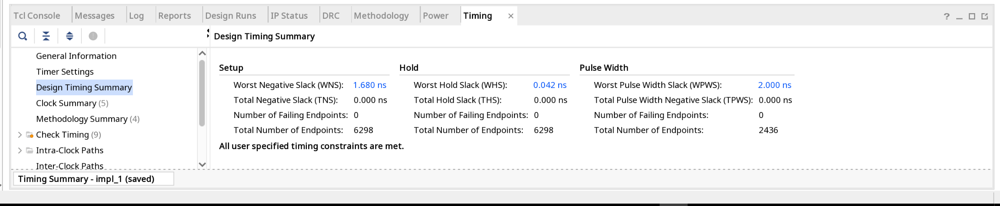

**WNS +1.680 нс** при періоді 10 нс, порушень 0 з 6298. Проєкт у час
вкладається із запасом близько 17%. Спочатку не вкладався зовсім: як
діставався цей запас - у розділі [Ресурси й час](#ресурси-й-час).

### Понад завдання

Дисплей SSD1306 по I2C, зібраний і перевірений на платі - фото й відео на
початку звіту.
